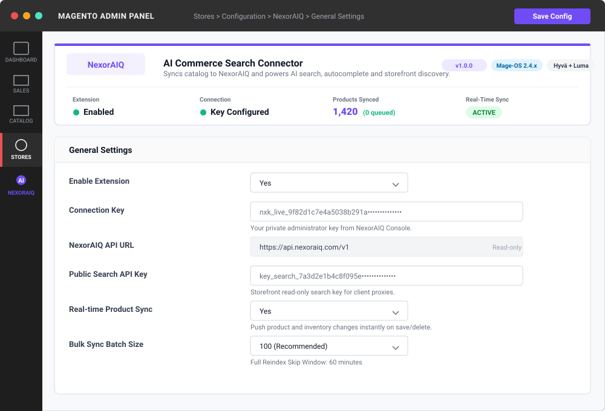
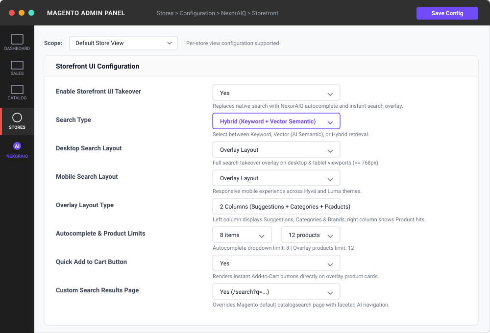
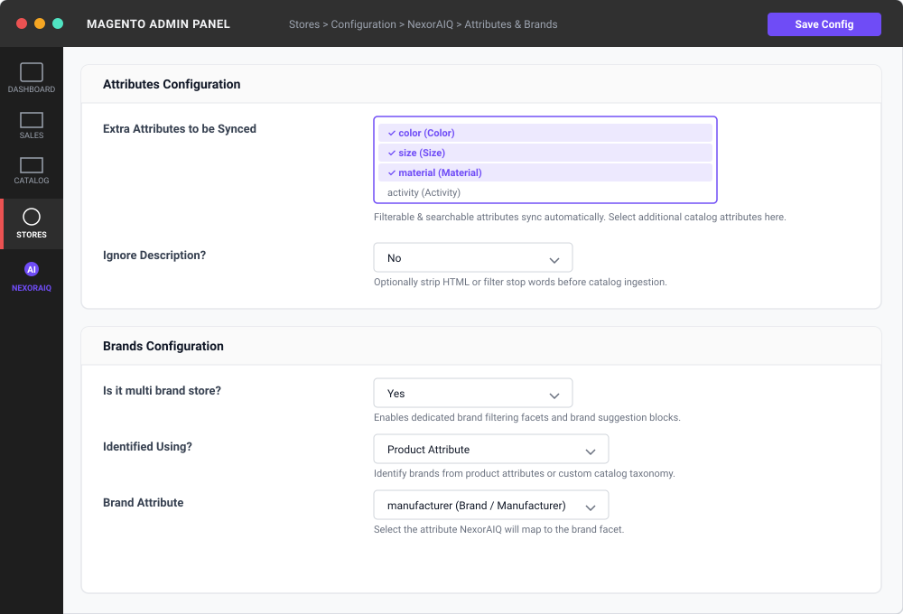
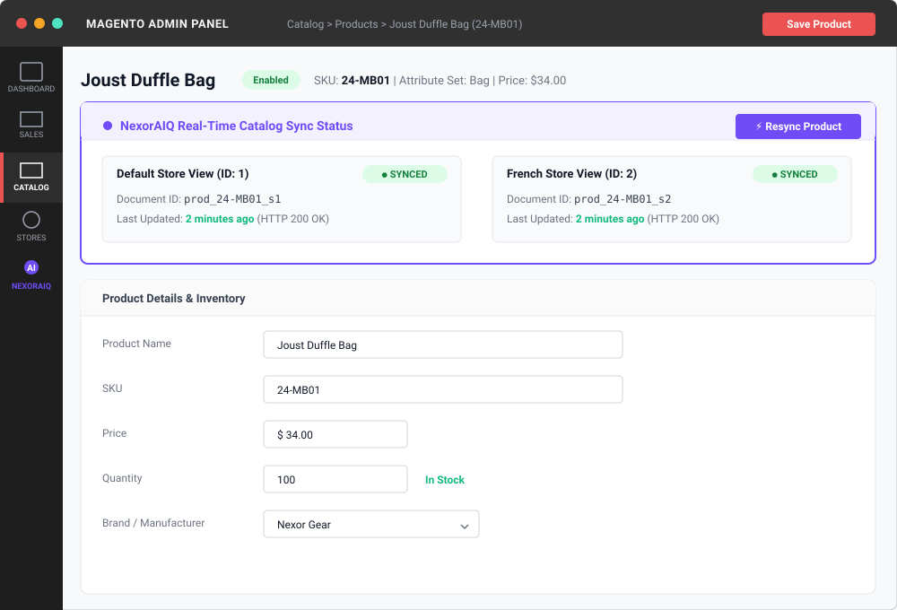

# NexorAIQ | AI Commerce Search - Magento 2 Connector

The **NexorAIQ Connector** (`NexorAIQ_Connector`) is the official Magento 2 extension for integrating [NexorAIQ](https://www.nexoraiq.tech) AI-powered search, autocomplete, product discovery, and shopper telemetry.

It provides out-of-the-box support for **Hyvä Themes**, standard **Luma / Blank** themes, and **Headless** (PWA, React, Next.js) storefront architectures with automatic theme detection.

---

## Key Features

- **AI Search & Autocomplete**: Keyword, vector semantic, or hybrid search modes configurable per store view.
- **Storefront UI Takeover**:
  - Autocomplete dropdown or fullscreen search overlay (1-column or 2-column layout with suggestions, categories, and brands).
  - Dedicated search results page with sorting, pagination, and layered navigation / swatches.
  - Quick "Add to Cart" directly from the search overlay and search results page.
- **Unified Theme Compatibility**:
  - **Hyvä Theme**: Native Alpine.js templates and Tailwind CSS styling.
  - **Luma & Blank Themes**: RequireJS and responsive CSS.
  - **Headless / PWA**: Secure GraphQL & REST search proxies.
- **Real-Time Catalog Sync**: Hooks into product save/delete events to instantly sync catalog changes to NexorAIQ.
- **Multi-Source Inventory (MSI) & Reservations**: Captures stock changes, warehouse inventory updates, and checkout stock reservations in real-time.
- **Headless Search Proxy**: All client-side search and telemetry requests are proxied securely through Magento, protecting your private API keys.
- **Shopper Telemetry & Analytics**: Captures search query interactions, product clicks, cart adds, and order conversions to continuously train search relevance.
- **Admin Sync Status**: Displays real-time sync status badges per store view on the product edit page, with on-demand manual sync capability.
- **Categorized Logging**: Isolated logging per subsystem (`var/log/NexoraIQ/`) for easy troubleshooting.

---

## Requirements

- **Magento**: Open Source / Commerce / Mage-OS 2.4.x
- **PHP**: 8.1, 8.2, or 8.3
- **NexorAIQ Account**: Active account with API credentials

---

## Installation

### 1. Install via Composer

Run the following command in your Magento root directory, provided the NexorAIQ Composer package repository is configured and your credentials grant access to the package:

```bash
composer require nexoraiq/connector
```

**Package availability:** This command requires `nexoraiq/connector` to be published in a Composer repository available to your project. If you have not configured the repository or the package is not publicly available, use the installation/distribution instructions supplied by NexorAIQ rather than assuming Packagist can resolve it.

### 2. Enable and Deploy

```bash
bin/magento module:enable NexorAIQ_Connector
bin/magento setup:upgrade
bin/magento setup:di:compile
bin/magento setup:static-content:deploy -f
bin/magento cache:flush
```

---

## Configuration

Navigate to **Stores > Configuration > NexorAIQ** in the Magento Admin Panel.

### 1. General Settings (**NexorAIQ > General Settings**)

| Setting | Description |
| --- | --- |
| **Enable Extension** | Enable or disable the NexorAIQ integration. |
| **Connection Key** | Your private administrator key (`nxk_live_...`) from the NexorAIQ dashboard. |
| **Public Search API Key** | Your public search API key (`key_search_...`) used by frontend search proxies. |
| **Real-time Product Sync** | Automatically push product and stock changes to NexorAIQ on save/delete. |
| **Bulk Sync Batch Size** | Number of products processed per batch during reindex (100, 150, 200, 300). |
| **Full Reindex Skip Window** | Skip products synced within X minutes during a full reindex (set 0 to reindex all). |
| **Attributes Configuration** | Select extra product attributes to sync beyond standard searchable/filterable attributes. |
| **Brands Configuration** | Map brand/manufacturer attributes for brand filtering and overlay sections. |

### 2. Storefront Settings (**NexorAIQ > Storefront**)

| Setting | Description |
| --- | --- |
| **Enable Storefront UI Takeover** | Enables NexorAIQ autocomplete and search results takeover. |
| **Search Type** | Retrieval strategy: `Keyword`, `Vector`, or `Hybrid` (configurable per store view). |
| **Desktop / Mobile Search Layout** | Choose between **Autocomplete Dropdown** or **Overlay Layout**. |
| **Overlay Layout Type** | 1-Column layout or 2-Columns layout (adds Suggestions, Categories, and Brands blocks). |
| **Search Results Page** | Enable custom search page route (e.g., `/search?q=...`), pagination, and filters. |
| **Add to Cart Button** | Enable quick Add-to-Cart buttons on the overlay and search results page. |

---

## Admin Panel Screenshots

### 1. General Settings & Connection Status
*Navigate to: **Stores > Configuration > NexorAIQ > General Settings***



- **Branded Header Banner**: Displays real-time connector status, live product sync counter, store views count, and active plan verification.
- **Connection Key**: Securely binds your Magento catalog with your NexorAIQ cluster (`nxk_live_...`).
- **Real-Time Sync**: Pushes instant updates on product saves, deletions, and MSI stock adjustments.

---

### 2. Storefront UI Takeover & Search Modes
*Navigate to: **Stores > Configuration > NexorAIQ > Storefront***



- **Search Type**: Choose between `Keyword`, `Vector` (AI semantic), or `Hybrid` search retrieval.
- **Responsive Layout**: Choose **Autocomplete Dropdown** or **Overlay Layout** (1-Column or 2-Columns with suggestions, brands, and categories).
- **Direct Add to Cart**: Enable quick conversion actions right within the search overlay and search results page.

---

### 3. Attributes & Brands Configuration
*Navigate to: **Stores > Configuration > NexorAIQ > General Settings > Attributes / Brands***



- **Extra Attributes**: Select non-standard product attributes to include in the AI search index.
- **Brand Identification**: Map custom manufacturer/brand attributes for brand facet filtering and dedicated overlay brand carousels.

---

### 4. Product Edit Page - Real-Time Sync Status Badge
*Navigate to: **Catalog > Products > Edit Product***



- **Live Status Badges**: See instant synchronization status (`SYNCED`, `IN QUEUE`, or `SKIPPED`) across each active store view.
- **On-Demand Resync**: Click **Resync Product** to trigger an immediate background or direct sync of the current entity.

---

## Indexing & Synchronization

### Full Reindex via CLI

To reindex your entire catalog into NexorAIQ, run:

```bash
bin/magento indexer:reindex nexoraiq_catalog
```

To check the indexer status:

```bash
bin/magento indexer:status nexoraiq_catalog
```

### Automated Background Queue

The connector registers a background cron job (`nexoraiq_index_queue`) that runs every minute to asynchronously process and synchronize queued product updates. Ensure your Magento cron is running:

```bash
bin/magento cron:run
```

---

## Headless API Reference

The connector provides secure proxy endpoints for headless storefronts (PWA Studio, Next.js, Vue Storefront, etc.).

### GraphQL API (`/graphql`)

#### Product Search

```graphql
query {
  nexoraiqSearch(
    query: "backpack"
    currentPage: 1
    pageSize: 12
    category: "Gear"
    minPrice: 10.0
    maxPrice: 150.0
    sortBy: "price_asc"
    inStockOnly: true
  ) {
    total
    currentPage
    totalPage
    searchTimeMs
    hits {
      id
      title
      sku
      price
      compareAtPrice
      imageUrl
      inStock
    }
  }
}
```

#### Autocomplete Suggestions

```graphql
query {
  nexoraiqAutocomplete(query: "back") {
    suggestions
    products {
      id
      title
      sku
      price
      imageUrl
    }
  }
}
```

#### Telemetry: Track Search Query

```graphql
mutation {
  nexoraiqTrackSearch(
    query: "backpack"
    sessionId: "sess_abc123"
    resultsCount: 24
    tookMs: 35
    device: "Desktop"
  )
}
```

#### Telemetry: Track Shopper Click Event

The GraphQL mutation is used for shopper click events. Add-to-cart and conversion events are recorded server-side by the extension; do not send a `revenue` argument to this mutation because it is not part of the declared schema.

```graphql
mutation {
  nexoraiqTrackEvent(
    eventType: "CLICK"
    productId: "1234"
    query: "backpack"
    sessionId: "sess_abc123"
  )
}
```

---

### REST API

All REST endpoints operate under `/rest/V1/nexoraiq/`:

| Method | Endpoint | Description |
| --- | --- | --- |
| `GET` | `/rest/V1/nexoraiq/search?query={query}` | Search catalog products |
| `GET` | `/rest/V1/nexoraiq/autocomplete?query={query}` | Autocomplete suggestions and products |
| `GET` | `/rest/V1/nexoraiq/config` | Retrieve storefront search configuration |
| `POST` | `/rest/V1/nexoraiq/analytics/search` | Track search query logs |
| `POST` | `/rest/V1/nexoraiq/analytics/event` | Track shopper events (clicks, add to cart, conversions) |

---

## Logs & Diagnostics

Subsystem-specific log files are written under the Magento `var/log/NexoraIQ/` directory:

| Log File | Subsystem |
| --- | --- |
| `var/log/NexoraIQ/indexer.log` | Bulk catalog reindexing and sync queue processing |
| `var/log/NexoraIQ/cron.log` | Scheduled background index queue executions |
| `var/log/NexoraIQ/observer.log` | Real-time product and stock save/delete observers |
| `var/log/NexoraIQ/plugin.log` | MSI source items and inventory reservation plugins |
| `var/log/NexoraIQ/webhook.log` | Outbound HTTP synchronization calls to NexorAIQ |
| `var/log/NexoraIQ/api.log` | REST API proxy requests and responses |
| `var/log/NexoraIQ/graphql.log` | GraphQL query and mutation resolvers |
| `var/log/NexoraIQ/admin.log` | Admin sync actions and configuration changes |

---

## Validation & Release Checklist

Before deploying to production, verify the following in a staging Magento installation:

- Confirm the exact Magento / Adobe Commerce / Mage-OS and PHP versions supported by the package release.
- Run Magento compilation, static content deployment where required, and cache flush; check that the module enables without DI or schema errors.
- Verify the connection from Magento Admin and confirm the store view, credentials, and subscription state.
- Run `bin/magento indexer:reindex nexoraiq_catalog`, confirm the indexer completes, and verify queue processing with Magento cron.
- Test product create/update/delete, price and inventory changes, MSI reservations, autocomplete, search filters, pagination, add-to-cart, and analytics.
- For headless integrations, test the documented GraphQL and REST contracts against the actual schema and endpoint authorization.
- Review exposed REST endpoints and ensure synchronization or administrative operations are protected against unauthorized use and abuse.

### Known documentation boundaries

- The GraphQL `nexoraiqTrackEvent` mutation accepts click events; add-to-cart and conversion events are logged server-side. It does not accept a `revenue` argument.
- The Composer install command works only when the package is published in a Composer repository accessible to the installing project.
- The compatibility list describes the intended support range; test each production target version before deployment.

## License

Proprietary. Copyright © NexorAIQ. All rights reserved.
